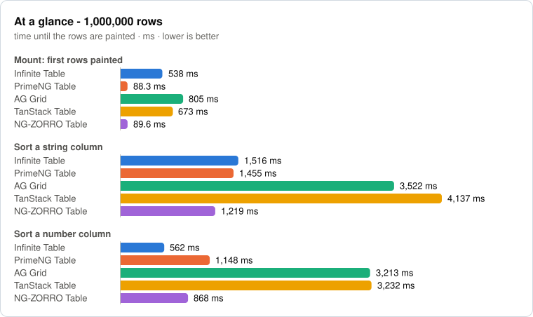
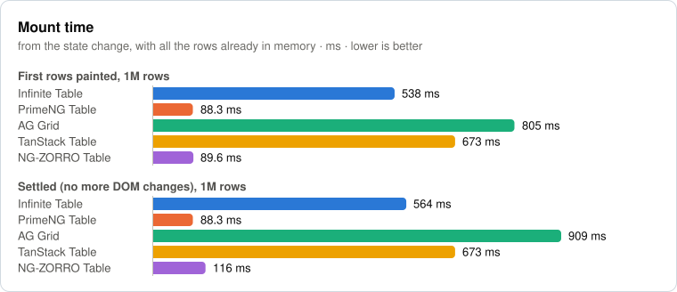
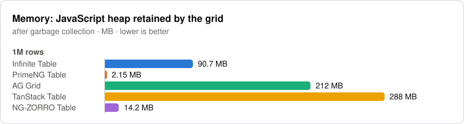
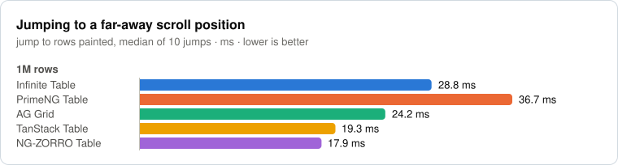
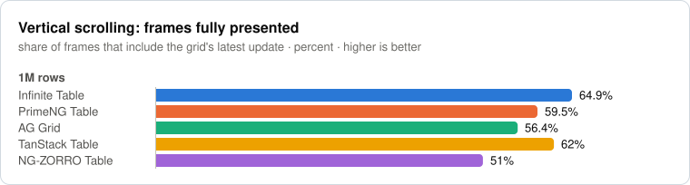
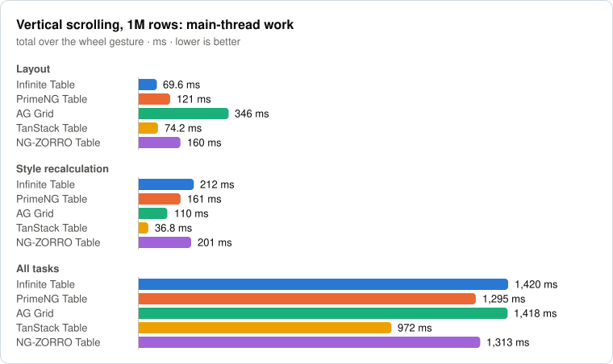
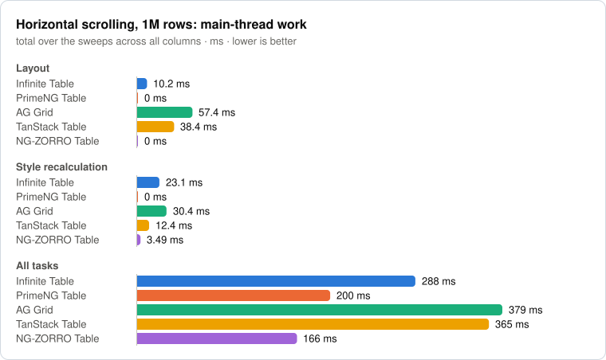

# Angular DataGrid performance comparison: Infinite Table, PrimeNG, AG Grid, TanStack Table and NG-ZORRO

A reproducible benchmark of five Angular DataGrids at 1,000,000 rows: mount
time, memory, sorting, scrolling and live data updates - with
the rows as they are, sorted, filtered, and grouped with aggregations.

- [Infinite Table for Angular](https://infinite-table.com/angular)
- [PrimeNG Table](https://primeng.org/table) (`p-table`), with its virtual
  scroller
- [AG Grid Angular](https://www.ag-grid.com/angular-data-grid/) (Community)
- [TanStack Table](https://tanstack.com/table), which is headless, rendered
  with [TanStack Virtual](https://tanstack.com/virtual) as in its official
  virtualization example
- [NG-ZORRO Table](https://ng.ant.design/components/table/en) (`nz-table`),
  with its virtual scroll

All of them are installed from npm, render the same data in the same browser,
and get the same interactions. The benchmark runs again whenever a new version
of any of them is published, and the results below are updated -
or you can [run it yourself](#run-it), with any versions.

It is the Angular counterpart of the
[React DataGrid performance comparison](https://github.com/infinite-table/datagrid-performance-comparison)
and of the
[Vue DataGrid performance comparison](https://github.com/infinite-table/vue-datagrid-performance-comparison):
the same data, scenarios, measuring code and statistics, with the Angular
grids.

The five are not the same kind of thing, and they don't all do everything the
scenarios ask for. Four things to know before reading the numbers - all are
explained in [What is compared](#what-is-compared):

- **TanStack Table renders nothing by itself.** What is measured is TanStack
  Table plus TanStack Virtual plus the markup of the official example - a
  much smaller thing than a full grid, with no keyboard navigation, cell
  selection, column menus or pinned columns.
- **NG-ZORRO Table sorts with the page's comparators.** It keeps the sort
  state and reorders the rows, but the compare function of every column comes
  from the page - as in its documentation.
- **PrimeNG Table and NG-ZORRO Table don't virtualize columns.** Every
  rendered row has all the 20 cells. Infinite Table, AG Grid and the TanStack
  page render only the columns in view.
- **With 1,000,000 rows, only Infinite Table and AG Grid can scroll to the
  last row.** PrimeNG Table, TanStack Table (with TanStack Virtual) and
  NG-ZORRO Table stop near row 838,860.

We make Infinite Table, so read this with healthy suspicion - that is why the
whole thing is here for you to run.

<!-- results:start - generated by scripts/update-results.ts, do not edit by hand -->

## Results

**Infinite Table for Angular 11.0.1**, **PrimeNG Table 21.1.10**, **AG Grid Angular 36.3.0** (Community), **TanStack Table 9.3.2** (with TanStack Virtual 6.1.14) and **NG-ZORRO Table 22.2.1** - measured on 2026-11-27, on GitHub Actions, ubuntu-24.04 (Intel(R) Xeon(R) 6975P-C × 4), in Chrome 136.0.7103.25 (headless). Every value is the median of 5 runs.

The absolute numbers depend on the machine - compare the grids, not the milliseconds. In the table under the charts, a difference is only called when the 95% confidence interval excludes "no difference".

<picture>
  <source media="(prefers-color-scheme: dark)" srcset="results/latest/charts/at-a-glance-dark.svg">
  
</picture>

<picture>
  <source media="(prefers-color-scheme: dark)" srcset="results/latest/charts/mount-dark.svg">
  
</picture>

<picture>
  <source media="(prefers-color-scheme: dark)" srcset="results/latest/charts/memory-dark.svg">
  
</picture>

<picture>
  <source media="(prefers-color-scheme: dark)" srcset="results/latest/charts/sort-1m-dark.svg">
  
</picture>

The string column is lowercase a-z text, sorted in an `en-US` browser. The grids do not compare strings the same way - see [String sorting](#string-sorting). NG-ZORRO Table sorts with the compare function the page gives each column, as in its documentation - see [NG-ZORRO Table](#ng-zorro-table-the-virtual-scroll-and-the-pages-comparators).

<picture>
  <source media="(prefers-color-scheme: dark)" srcset="results/latest/charts/scroll-jump-dark.svg">
  
</picture>

With 1M rows, the last row that can be scrolled to is not the last row of the data in: PrimeNG Table (row 838,881), TanStack Table (row 838,860), NG-ZORRO Table (row 838,861). Infinite Table and AG Grid reach the last row. See [Scroll range](#scroll-range).

<picture>
  <source media="(prefers-color-scheme: dark)" srcset="results/latest/charts/scroll-frames-dark.svg">
  
</picture>

<picture>
  <source media="(prefers-color-scheme: dark)" srcset="results/latest/charts/scroll-vertical-work-dark.svg">
  
</picture>

<picture>
  <source media="(prefers-color-scheme: dark)" srcset="results/latest/charts/scroll-horizontal-work-dark.svg">
  
</picture>

<picture>
  <source media="(prefers-color-scheme: dark)" srcset="results/latest/charts/updates-low-1m-dark.svg">
  
</picture>

<picture>
  <source media="(prefers-color-scheme: dark)" srcset="results/latest/charts/updates-high-1m-dark.svg">
  
</picture>

<picture>
  <source media="(prefers-color-scheme: dark)" srcset="results/latest/charts/updates-high-fps-1m-dark.svg">
  
</picture>

<picture>
  <source media="(prefers-color-scheme: dark)" srcset="results/latest/charts/updates-high-work-1m-dark.svg">
  
</picture>

<details>
<summary>The same numbers, as a table - and how Infinite Table compares with each grid</summary>

| | Infinite Table | PrimeNG Table | AG Grid | TanStack Table | NG-ZORRO Table | Infinite Table vs each grid |
|---|---:|---:|---:|---:|---:|---|
| Mount - First rows painted, 1M rows | 538 ms | 88.3 ms | 805 ms | 673 ms | 89.6 ms | vs PrimeNG Table: **PrimeNG Table** 6.09× lower<br>vs AG Grid: **Infinite Table** 33% lower<br>vs TanStack Table: **Infinite Table** 20% lower<br>vs NG-ZORRO Table: **NG-ZORRO Table** 6× lower |
| Mount - Settled (no more DOM changes), 1M rows | 564 ms | 88.3 ms | 909 ms | 673 ms | 116 ms | vs PrimeNG Table: **PrimeNG Table** 6.38× lower<br>vs AG Grid: **Infinite Table** 38% lower<br>vs TanStack Table: **Infinite Table** 16% lower<br>vs NG-ZORRO Table: **NG-ZORRO Table** 4.84× lower |
| Memory - 1M rows | 90.7 MB | 2.15 MB | 212 MB | 288 MB | 14.2 MB | vs PrimeNG Table: **PrimeNG Table** 42.1× lower<br>vs AG Grid: **Infinite Table** 2.34× lower<br>vs TanStack Table: **Infinite Table** 3.18× lower<br>vs NG-ZORRO Table: **NG-ZORRO Table** 6.39× lower |
| Sort, 1M rows - String column, ascending | 1,516 ms | 1,455 ms | 3,522 ms | 4,137 ms | 1,219 ms | vs PrimeNG Table: no significant difference<br>vs AG Grid: **Infinite Table** 2.32× lower<br>vs TanStack Table: **Infinite Table** 2.73× lower<br>vs NG-ZORRO Table: **NG-ZORRO Table** 20% lower |
| Sort, 1M rows - String column, descending | 1,605 ms | 289 ms | 3,586 ms | 4,041 ms | 1,240 ms | vs PrimeNG Table: **PrimeNG Table** 5.55× lower<br>vs AG Grid: **Infinite Table** 2.23× lower<br>vs TanStack Table: **Infinite Table** 2.52× lower<br>vs NG-ZORRO Table: **NG-ZORRO Table** 23% lower |
| Sort, 1M rows - Number column, ascending | 562 ms | 1,148 ms | 3,213 ms | 3,232 ms | 868 ms | vs PrimeNG Table: **Infinite Table** 2.04× lower<br>vs AG Grid: **Infinite Table** 5.72× lower<br>vs TanStack Table: **Infinite Table** 5.75× lower<br>vs NG-ZORRO Table: **Infinite Table** 35% lower |
| Sort, 1M rows - Number column, descending | 519 ms | 443 ms | 3,291 ms | 3,135 ms | 901 ms | vs PrimeNG Table: **PrimeNG Table** 15% lower<br>vs AG Grid: **Infinite Table** 6.34× lower<br>vs TanStack Table: **Infinite Table** 6.04× lower<br>vs NG-ZORRO Table: **Infinite Table** 42% lower |
| Jump to rows painted - 1M rows | 28.8 ms | 36.7 ms | 24.2 ms | 19.3 ms | 17.9 ms | vs PrimeNG Table: **Infinite Table** 22% lower<br>vs AG Grid: **AG Grid** 16% lower<br>vs TanStack Table: **TanStack Table** 33% lower<br>vs NG-ZORRO Table: **NG-ZORRO Table** 38% lower |
| Vertical scrolling, frames fully presented - 1M rows | 64.9% | 59.5% | 56.4% | 62% | 51% | vs PrimeNG Table: **Infinite Table** 5.37 points higher<br>vs AG Grid: **Infinite Table** 8.47 points higher<br>vs TanStack Table: **Infinite Table** 2.82 points higher<br>vs NG-ZORRO Table: **Infinite Table** 13.9 points higher |
| Vertical scrolling, 1M rows, main-thread work - Layout | 69.6 ms | 121 ms | 346 ms | 74.2 ms | 160 ms | vs PrimeNG Table: **Infinite Table** 42% lower<br>vs AG Grid: **Infinite Table** 4.96× lower<br>vs TanStack Table: no significant difference<br>vs NG-ZORRO Table: **Infinite Table** 2.3× lower |
| Vertical scrolling, 1M rows, main-thread work - Style recalculation | 212 ms | 161 ms | 110 ms | 36.8 ms | 201 ms | vs PrimeNG Table: **PrimeNG Table** 24% lower<br>vs AG Grid: **AG Grid** 48% lower<br>vs TanStack Table: **TanStack Table** 5.76× lower<br>vs NG-ZORRO Table: **NG-ZORRO Table** 5% lower |
| Vertical scrolling, 1M rows, main-thread work - All tasks | 1,420 ms | 1,295 ms | 1,418 ms | 972 ms | 1,313 ms | vs PrimeNG Table: **PrimeNG Table** 9% lower<br>vs AG Grid: no significant difference<br>vs TanStack Table: **TanStack Table** 32% lower<br>vs NG-ZORRO Table: **NG-ZORRO Table** 8% lower |
| Horizontal scrolling, 1M rows, main-thread work - Layout | 10.2 ms | 0 ms | 57.4 ms | 38.4 ms | 0 ms | vs PrimeNG Table: **PrimeNG Table** 100% lower<br>vs AG Grid: **Infinite Table** 5.61× lower<br>vs TanStack Table: **Infinite Table** 3.75× lower<br>vs NG-ZORRO Table: **NG-ZORRO Table** 100% lower |
| Horizontal scrolling, 1M rows, main-thread work - Style recalculation | 23.1 ms | 0 ms | 30.4 ms | 12.4 ms | 3.49 ms | vs PrimeNG Table: **PrimeNG Table** 100% lower<br>vs AG Grid: **Infinite Table** 24% lower<br>vs TanStack Table: **TanStack Table** 46% lower<br>vs NG-ZORRO Table: **NG-ZORRO Table** 6.61× lower |
| Horizontal scrolling, 1M rows, main-thread work - All tasks | 288 ms | 200 ms | 379 ms | 365 ms | 166 ms | vs PrimeNG Table: **PrimeNG Table** 31% lower<br>vs AG Grid: **Infinite Table** 24% lower<br>vs TanStack Table: **Infinite Table** 21% lower<br>vs NG-ZORRO Table: **NG-ZORRO Table** 43% lower |
| Live updates, 1M rows - Rows as they are | 428 ms | 22.3 ms | 130 ms | 500 ms | 27.6 ms | vs PrimeNG Table: **PrimeNG Table** 19.2× lower<br>vs AG Grid: **AG Grid** 3.31× lower<br>vs TanStack Table: **Infinite Table** 14% lower<br>vs NG-ZORRO Table: **NG-ZORRO Table** 15.5× lower |
| Live updates, 1M rows - Sorted by the salary, which the updates change | 548 ms | 1,501 ms | 4,149 ms | 4,069 ms | 1,130 ms | vs PrimeNG Table: **Infinite Table** 2.74× lower<br>vs AG Grid: **Infinite Table** 7.57× lower<br>vs TanStack Table: **Infinite Table** 7.42× lower<br>vs NG-ZORRO Table: **Infinite Table** 2.06× lower |
| Live updates, 1M rows - Filtered on the salary | 300 ms | 71.9 ms | 257 ms | 1,438 ms | 53.9 ms | vs PrimeNG Table: **PrimeNG Table** 4.17× lower<br>vs AG Grid: **AG Grid** 14% lower<br>vs TanStack Table: **Infinite Table** 4.8× lower<br>vs NG-ZORRO Table: **NG-ZORRO Table** 5.56× lower |
| Live updates, 1M rows - Grouped by department, salaries summed | 806 ms | – | – | 1,806 ms | – | vs TanStack Table: **Infinite Table** 2.24× lower |
| A feed of 50 updates a second, 1M rows, lag at the end - Rows as they are | 407 ms | 22.4 ms | 163 ms | 750 ms | 31.3 ms | vs PrimeNG Table: **PrimeNG Table** 18.1× lower<br>vs AG Grid: **AG Grid** 2.49× lower<br>vs TanStack Table: **Infinite Table** 46% lower<br>vs NG-ZORRO Table: **NG-ZORRO Table** 13× lower |
| A feed of 50 updates a second, 1M rows, lag at the end - Sorted by the salary, which the updates change | 930 ms | 1,899 ms | 7,604 ms | 7,481 ms | 1,834 ms | vs PrimeNG Table: **Infinite Table** 2.04× lower<br>vs AG Grid: **Infinite Table** 8.18× lower<br>vs TanStack Table: **Infinite Table** 8.05× lower<br>vs NG-ZORRO Table: **Infinite Table** 49% lower |
| A feed of 50 updates a second, 1M rows, lag at the end - Filtered on the salary | 426 ms | 113 ms | 387 ms | 1,114 ms | 87.6 ms | vs PrimeNG Table: **PrimeNG Table** 3.76× lower<br>vs AG Grid: no significant difference<br>vs TanStack Table: **Infinite Table** 2.62× lower<br>vs NG-ZORRO Table: **NG-ZORRO Table** 4.86× lower |
| A feed of 50 updates a second, 1M rows, lag at the end - Grouped by department, salaries summed | 1,511 ms | – | – | 2,007 ms | – | vs TanStack Table: **Infinite Table** 25% lower |
| A feed of 50 updates a second, 1M rows, frame rate - Rows as they are | 2.67 fps | 49.4 fps | 7.75 fps | 1.9 fps | 43.6 fps | vs PrimeNG Table: **PrimeNG Table** 18.5× higher<br>vs AG Grid: **AG Grid** 2.9× higher<br>vs TanStack Table: **Infinite Table** 40% higher<br>vs NG-ZORRO Table: **NG-ZORRO Table** 16.3× higher |
| A feed of 50 updates a second, 1M rows, frame rate - Sorted by the salary, which the updates change | 1.63 fps | 0.68 fps | 0.16 fps | 0.26 fps | 0.86 fps | vs PrimeNG Table: **Infinite Table** 2.4× higher<br>vs AG Grid: **Infinite Table** 10.2× higher<br>vs TanStack Table: **Infinite Table** 6.24× higher<br>vs NG-ZORRO Table: **Infinite Table** 90% higher |
| A feed of 50 updates a second, 1M rows, frame rate - Filtered on the salary | 3.22 fps | 14 fps | 3.66 fps | 0.79 fps | 19.4 fps | vs PrimeNG Table: **PrimeNG Table** 4.34× higher<br>vs AG Grid: **AG Grid** 14% higher<br>vs TanStack Table: **Infinite Table** 4.1× higher<br>vs NG-ZORRO Table: **NG-ZORRO Table** 6.03× higher |
| A feed of 50 updates a second, 1M rows, frame rate - Grouped by department, salaries summed | 1.09 fps | – | – | 0.51 fps | – | vs TanStack Table: **Infinite Table** 2.15× higher |
| A feed of 50 updates a second, 1M rows, main-thread work - Rows as they are | 4,392 ms | 3,940 ms | 4,143 ms | 4,732 ms | 4,004 ms | vs PrimeNG Table: **PrimeNG Table** 10% lower<br>vs AG Grid: **AG Grid** 6% lower<br>vs TanStack Table: **Infinite Table** 7% lower<br>vs NG-ZORRO Table: **NG-ZORRO Table** 9% lower |
| A feed of 50 updates a second, 1M rows, main-thread work - Sorted by the salary, which the updates change | 4,920 ms | 5,880 ms | 11,586 ms | 11,462 ms | 5,816 ms | vs PrimeNG Table: **Infinite Table** 16% lower<br>vs AG Grid: **Infinite Table** 2.36× lower<br>vs TanStack Table: **Infinite Table** 2.33× lower<br>vs NG-ZORRO Table: **Infinite Table** 15% lower |
| A feed of 50 updates a second, 1M rows, main-thread work - Filtered on the salary | 4,412 ms | 4,106 ms | 4,368 ms | 5,105 ms | 4,067 ms | vs PrimeNG Table: **PrimeNG Table** 7% lower<br>vs AG Grid: no significant difference<br>vs TanStack Table: **Infinite Table** 14% lower<br>vs NG-ZORRO Table: **NG-ZORRO Table** 8% lower |
| A feed of 50 updates a second, 1M rows, main-thread work - Grouped by department, salaries summed | 5,501 ms | – | – | 5,988 ms | – | vs TanStack Table: **Infinite Table** 8% lower |

</details>

Every metric of every scenario, with standard deviations and confidence intervals: [full report](./results/latest/report.md) · [raw samples](./results/latest/results.json).

## History

Every set of versions measured so far, newest first, with a row for each grid. All the values are times in ms, except memory, in MB - lower is better. Runs measured on different machines can't be compared in absolute terms (hosted runners don't all have the same CPU) - compare how the grids relate within a run. The branch of a run has the code, the lockfile and the full results of that run.

| Run | Grid | Mount 1M | Sort string 1M | Sort number 1M | Memory 1M | Vertical scroll work 1M | Horizontal scroll work 1M | Update sorted 1M | Feed lag sorted 1M |
|---|---|---:|---:|---:|---:|---:|---:|---:|---:|
| 2026-11-27<br>GitHub Actions, ubuntu-24.04 · Intel(R) Xeon(R) 6975P-C × 4<br>[branch](https://github.com/infinite-table/angular-datagrid-performance-comparison/tree/versions/infinite-11.0.1_primeng-21.1.10_ag-grid-36.3.0_tanstack-9.3.2_ng-zorro-22.2.1) | Infinite Table 11.0.1 | 538 | 1,516 | 562 | 90.7 | 1,420 | 288 | 548 | 930 |
|  | PrimeNG Table 21.1.10 | 88.3 | 1,455 | 1,148 | 2.15 | 1,295 | 200 | 1,501 | 1,899 |
|  | AG Grid 36.3.0 | 805 | 3,522 | 3,213 | 212 | 1,418 | 379 | 4,149 | 7,604 |
|  | TanStack Table 9.3.2 | 673 | 4,137 | 3,232 | 288 | 972 | 365 | 4,069 | 7,481 |
|  | NG-ZORRO Table 22.2.1 | 89.6 | 1,219 | 868 | 14.2 | 1,313 | 166 | 1,130 | 1,834 |
| 2026-11-26<br>GitHub Actions, ubuntu-24.04 · AMD EPYC 7763 64-Core Processor × 4<br>[branch](https://github.com/infinite-table/angular-datagrid-performance-comparison/tree/versions/infinite-11.0.0_primeng-21.1.10_ag-grid-36.3.0_tanstack-9.3.2_ng-zorro-22.2.1) | Infinite Table 11.0.0 | 589 | 1,773 | 656 | 90.6 | 1,897 | 374 | 586 | 865 |
|  | PrimeNG Table 21.1.10 | 125 | 1,591 | 1,339 | 2.15 | 1,704 | 257 | 1,654 | 2,888 |
|  | AG Grid 36.3.0 | 948 | 3,465 | 2,959 | 212 | 1,871 | 491 | 3,739 | 7,555 |
|  | TanStack Table 9.3.2 | 866 | 4,280 | 3,565 | 288 | 1,297 | 528 | 4,191 | 4,978 |
|  | NG-ZORRO Table 22.2.1 | 119 | 1,407 | 903 | 14.2 | 1,702 | 198 | 1,338 | 1,546 |

<!-- results:end -->

## Run it

You need git and Node.js 22.22.3 or newer (we used 24) - what Angular 22's
CLI asks for. It runs on macOS and Linux. Playwright downloads its own
Chromium, so it doesn't matter which browser you have installed.

```sh
git clone https://github.com/infinite-table/angular-datagrid-performance-comparison.git
cd angular-datagrid-performance-comparison
npm install
npx playwright install chromium

# production build, then every scenario at 1M rows
BENCH_HEADLESS=1 npm run benchmark
```

A full run is 17 scenarios × 5 grids × 6 runs - 1 warmup and 5 measured - at
1M rows (the 2 grouped scenarios with 2 grids): about an hour and a half on a
GitHub-hosted runner. `BENCH_SIZES=300k,1m` adds a 300,000 rows dataset, for
about 50 minutes more. Without `BENCH_HEADLESS=1` it opens real browser
windows - closer to what users see, but you have to leave the machine alone
while they come and go.

For numbers you can trust, close other apps, keep a laptop plugged in, and
don't use the machine during the run.

To try it first, this takes a few minutes:

```sh
npm run benchmark:build
# mount and string sorting, 300k rows only, 3 runs per grid
BENCH_HEADLESS=1 BENCH_SIZES=300k BENCH_SCENARIOS=mount,sort-string BENCH_RUNS=3 npm run benchmark:run
```

`npm run benchmark:run` reuses the last build. Build again after you change
the code or the installed versions.

### Results

Every run writes two files to `benchmark-results/<run id>/`:

- `report.md` - one table per scenario, with the median and standard deviation
  of each grid and, for Infinite Table against each of the others, the ratio,
  its 95% confidence interval, and which grid is better when the difference is
  significant
- `results.json` - every raw sample of every run

The most recent report is also copied to `benchmark-results/latest.md`.
`benchmark-results/` is git-ignored.

## Compare other versions

The versions that are measured are the ones installed in `node_modules`. The
report records them.

```sh
npm install @infinite-table/infinite-angular@<version>
# PrimeNG 21 goes with @primeuix/themes 2
npm install primeng@<version> @primeuix/themes@<version>
npm install ag-grid-community@<version> ag-grid-angular@<version>
npm install @tanstack/angular-table@<version> @tanstack/angular-virtual@<version>
npm install ng-zorro-antd@<version>

BENCH_HEADLESS=1 npm run benchmark
```

Keep `ag-grid-community` and `ag-grid-angular` on the same version. All the
grids run on the same Angular - 22, which Infinite Table for Angular and
NG-ZORRO 22 ask for. PrimeNG 21 declares Angular 21 as its peer dependency;
the `overrides` in `package.json` let npm install it next to Angular 22 (see
[PrimeNG Table](#primeng-table-the-virtual-scroller-mode)).

To measure only some of the grids, name them: `BENCH_GRIDS=infinite,tanstack`
(`infinite`, `primeng`, `ag-grid`, `tanstack`, `ng-zorro`).

## How the results above are kept up to date

The [Benchmark workflow](./.github/workflows/benchmark.yml) runs on GitHub
Actions:

- every 6 hours it looks on npm for a new version of
  `@infinite-table/infinite-angular`, `primeng` (21.x only), `ag-grid-angular`,
  `@tanstack/angular-table` or `ng-zorro-antd`. When there is one, it installs
  it, runs the whole benchmark and commits the results
- it can also be started by hand, for any versions of the five: Actions >
  Benchmark > Run workflow
- a `repository_dispatch` event of type `new-version` starts it right away,
  for a release pipeline that doesn't want to wait for the schedule

Where the results go:

- **`master`** always has the newest versions: `package.json`,
  `results/latest` (the report and the raw samples) and
  the charts above
- **a branch for every set of versions** that was measured -
  `versions/infinite-<version>_primeng-<version>_ag-grid-<version>_tanstack-<version>_ng-zorro-<version>` -
  with the code, the lockfile and the full results of that run
- **the history table** on `master` has the rows of every one of
  them, from `results/history.json`

The hosted runners are shared virtual machines without a GPU, and their CPU
can change from one run to the next (the history table says which one it was).
So the absolute numbers differ between runs. What the benchmark is after is
how the grids relate - every run goes through all of them in turn, so they
get the same conditions.

If a run fails, the workflow opens an issue and stops trying those versions
until the issue is closed.

To update the README from a run on your machine:
`node --no-warnings scripts/update-results.ts <run id>`.

## Look at the grids

The pages the benchmark measures are ordinary pages you can open and scroll:

```sh
npm run benchmark:build
npm run benchmark:serve     # or: npm run dev
```

Then open [localhost:5580](http://localhost:5580) (`npm run dev`:
[localhost:4200](http://localhost:4200)) for the list - a page for each grid
and size: `/benchmark/<grid>-<size>`, where the grid is `infinite`,
`primeng`, `ag-grid`, `tanstack` or `ng-zorro` and the size is `300k` or `1m`.
If the port is taken, pick another one with
`npm run benchmark:serve -- --port 4000`.

## What is compared

Each grid is on its defaults. Only what makes the layouts identical is set:

- **Data:** 1,000,000 rows × 20 columns, generated deterministically
  ([`data.ts`](./src/benchmark/data.ts)). Every grid imports the same module,
  and the setup checks a checksum and that all the grids show the same text in
  the visible cells. `BENCH_SIZES=300k,1m` adds a run with 300,000 rows - the
  grids mostly rank the same, and scrolling does not depend on the row count.
- **The rows are plain objects**, the same array for every grid. Angular
  doesn't wrap them: the page keeps the array in a signal, which is set once.
- **Same row height, header height and column widths**: 40px, 40px and 150px.
- **All the rows in one scrollable view.**
- **Each page loads only its own grid** - its code and its styles. Every page
  is a lazy chunk of one Angular application (an `@angular/build`
  production build); the stylesheet of a grid is the stylesheet of its
  component, which comes with that chunk.
- **The same Angular**, 22, with its default zoneless change detection
  (no zone.js): every grid is told about changes by signals, inputs and
  template events.
- **The same body height.** The setup measures the scrolling body of every
  grid and makes the boxes of the shorter ones taller until they match (to
  within a pixel), so all of them render the same number of rows. The grids
  differ by the few pixels of their borders, and Infinite Table by its footer
  (see [License keys](#license-keys)); the report says by how much.

What is set for each grid, and why:

- **Infinite Table:** nothing else. See
  [`infinite-benchmark.ts`](./src/benchmark/infinite/infinite-benchmark.ts).
- **PrimeNG Table:** see below, and
  [`primeng-grid.ts`](./src/benchmark/primeng/primeng-grid.ts).
- **AG Grid:** the Quartz theme, all Community modules, `animateRows: false`
  (the other grids don't animate rows on sort, and the animation would make
  "sorted rows visible" ambiguous) and a `getRowId` (the other grids have a
  row id too). The rows are given through the `rowData` input, as in its
  documentation. See
  [`ag-grid-benchmark.ts`](./src/benchmark/ag-grid/ag-grid-benchmark.ts).
- **TanStack Table:** see below, and
  [`tanstack-grid.ts`](./src/benchmark/tanstack/tanstack-grid.ts).
- **NG-ZORRO Table:** see below, and
  [`ng-zorro-grid.ts`](./src/benchmark/ng-zorro/ng-zorro-grid.ts).

### PrimeNG Table: the virtual scroller mode

`p-table` renders every row unless its virtual scroller is turned on. The
page follows the "Virtual Scroll" example of its
[documentation](https://primeng.org/table):

- `scrollable`, `scrollHeight="flex"`, `virtualScroll` and
  `virtualScrollItemSize: 40` - the item size is the row height
- the Aura theme preset (`@primeuix/themes`), the one its documentation starts
  with, through `providePrimeNG`
- sortable headers (`pSortableColumn`) with their sort icons
  (`p-sortIcon`), as in its "Sort" example
- the table has `table-layout: fixed` and the width of all the columns, and
  the cells have a height of 40px and no vertical padding, so a row is exactly
  40px high
- a `data-row-index` attribute on the rows, for the measuring code

**It does not virtualize columns.** Every rendered row has all the 20 cells.

**It sorts the array it is given, in place**, and then keeps a copy of it.
The page keeps its rows in the order of the data, to apply the live updates
to, so in the sorted view of the live-update scenarios it gives the table a
copy of them - one more copy of the array per update, which takes a few
milliseconds next to the sorting. In the other views the table gets the
page's array, as in the other grids.

**The benchmark measures PrimeNG 21**, the last MIT-licensed major version.
PrimeNG 22 asks for a license key - see [License keys](#license-keys).
PrimeNG 21 declares Angular 21 as its peer dependency; it is installed next
to Angular 22 (the `overrides` in `package.json`), and the setup checks that
it renders the same rows as the others.

### TanStack Table: a headless library and our markup

TanStack Table has the row model and the sorting, and renders nothing. What
the benchmark measures is the combination its documentation recommends for
large tables: TanStack Table, [TanStack Virtual](https://tanstack.com/virtual)
for the rows and the columns, and plain `<table>` markup. The page follows the
official Angular
[virtualized-columns example](https://github.com/TanStack/table/tree/main/examples/angular/virtualized-columns)
(`injectTable`, `injectVirtualizer`, the `FlexRender` directives), with the
same overscan (5 rows, 3 columns). What we changed:

- a fixed row height, so nothing is measured while scrolling (the example
  measures every row, for dynamic heights)
- no column resizing, and no column visibility feature
- `sortDescFirst: false` - by default the first click on a number column
  sorts descending; in the other grids it sorts ascending
- `data-row-index` and `data-column-id` attributes on the cells, for the
  measuring code
- the styles of the Vue and React benchmarks, so the page looks the same

Keep in mind what is being compared when you read its numbers. This page has
no keyboard navigation, focus handling, selection, column menus, resizing,
reordering or pinning, and renders fewer DOM elements than any of the others -
which is the point of a headless library, and it is also less work on every
frame.

### NG-ZORRO Table: the virtual scroll, and the page's comparators

`nz-table` renders the rows of a page at a time, unless its virtual scroll is
turned on. The page follows the "Virtual" example of its
[documentation](https://ng.ant.design/components/table/en):

- `nzVirtualItemSize: 40` (the row height), `nzFrontPagination` and
  `nzShowPagination` off - all the rows in one view - and `nzScroll`, with the
  width of all the columns and the height of the body in px, which the
  virtual scroll requires. The body is a CDK virtual scroll viewport.
- `nzWidthConfig` for the column widths, and a `nzVirtualForTrackBy` on the
  row id
- its stylesheet, `ng-zorro-antd.min.css`, as its "Getting started" installs
  it (only on its own pages)
- English texts (`provideNzI18n(en_US)` - the default is Chinese)
- a `data-row-index` attribute on the rows, for the measuring code

**Sorting:** every header is sortable through `nzSortFn`. NG-ZORRO keeps the
sort state, cycles through ascending, descending and unsorted on clicks, and
sorts the rows - with the compare function the page gives it, which is
required: the comparators are the ones of the "Sort" examples of its
documentation (`a - b` for numbers, `localeCompare` for strings). With
sortable columns, NG-ZORRO copies and sorts the rows whenever they change,
even when no column is sorted (with a comparator that finds every pair
equal) - that is part of what is measured.

**It does not virtualize columns**: every rendered row has all the 20 cells.

**The header is a table of its own**, above the body: NG-ZORRO scrolls it
horizontally when the body scrolls, from a scroll listener.

### Scroll range

Browsers cap the size of an element (about 33.5M px in Chrome), and 1,000,000
rows × 40px is 40M px. A grid has to map its scrollbar onto the rows to show
all of them.

- **Infinite Table and AG Grid** do, and reach the last row.
- **PrimeNG Table, TanStack Virtual and NG-ZORRO Table** (a CDK virtual
  scroll viewport) don't: the element is cut at the browser's limit, and the
  last row that can be scrolled to is near row 838,860. The rows after it -
  about 161,000 - are loaded and sorted, and can't be seen. Their 1M scrolling
  results are for the part that can be reached; and because their scrollbar
  is not stretched, the same wheel gesture goes over about 20% fewer rows than
  in the other two grids.

The report has these numbers for every run, under each size.

### Scenarios

| Id                       |                                                                                            |
| ------------------------ | ------------------------------------------------------------------------------------------ |
| `mount`                  | mount the grid with all rows in memory: time to first rows painted, to settled, heap, DOM  |
| `sort-string`            | click a string column header - ascending (cold), then descending                           |
| `sort-number`            | the same, for a number column                                                              |
| `scroll-jump`            | ten programmatic jumps to far-away scroll positions                                        |
| `scroll-vertical`        | a wheel gesture down: frame rate, frame outcomes, main-thread work                         |
| `scroll-horizontal`      | wheel sweeps across all the columns                                                        |
| `correctness-vertical`   | during a very fast vertical scroll: is every cell there, and is it the right one?          |
| `correctness-horizontal` | the same, horizontally                                                                     |
| `visual-blank-vertical`  | a screencast of a very fast scroll: how many blank rows does the compositor actually show? |
| `updates-low`            | live updates, one at a time: update to rows painted                                        |
| `updates-low-sorted`     | the same, with the rows sorted by the column that changes                                  |
| `updates-low-filtered`   | the same, with the rows filtered on the column that changes                                |
| `updates-low-grouped`    | the same, with the rows grouped and the changing column summed (Infinite, TanStack)        |
| `updates-high`           | a feed of 50 updates a second: lag at the end, update delay, frame rate, main-thread work  |
| `updates-high-sorted`    | the same, sorted                                                                           |
| `updates-high-filtered`  | the same, filtered                                                                         |
| `updates-high-grouped`   | the same, grouped (Infinite, TanStack)                                                     |

Every grid runs every scenario, except the grouped ones - see
[Live updates](#live-updates).

### Live updates

Rows change while the grid shows them - like prices in a trading blotter.
An update changes four number fields (`salary`, `bonus`, `hours`, `score`, by
up to ±1%) in new copies of some rows: random rows, plus all the rows in the
viewport, so that every update changes what is on screen. Every grid gets the
same updates ([`updates.ts`](./src/benchmark/updates.ts)), worked out before
anything is measured, and each one is checked on screen: the right rows, with
the new values, in the right order.

The grid shows the rows in one of four views, set when it mounts:

- **as they are** - in the order of the data
- **sorted** by the salary, highest first - the updates change the salaries,
  so rows move
- **filtered** to a salary of at least 115,000, about half of the rows - rows
  go in and out of the filter
- **grouped** by department (10 collapsed groups), with the sum of the
  salaries of each group in the salary column - the sums change. Only
  Infinite Table and TanStack Table are measured here: PrimeNG Table groups
  rows for display but leaves the aggregations to the page, AG Grid has row
  grouping and aggregation in Enterprise, and NG-ZORRO Table has no row
  grouping.

and the updates come in one of two ways:

- **low frequency** (`updates-low-*`): 5 updates of 1,000 random rows each,
  one at a time - each one 500 ms after the previous one is painted. Measured
  from sending the update to the first frame that shows it.
- **high frequency** (`updates-high-*`): a feed of 50 updates a second, of
  100 random rows each, for 4 seconds. The page hands the grid the updates
  once per animation frame - all those that arrived since the previous frame,
  as one update, the way an app buffers the messages of a socket. A grid that
  keeps the main thread busy gets them later, and more at once. Measured: the
  lag at the end (from the last update to the frame that shows it), how late
  the updates get to the grid, and the main-thread work. The frame rate, the
  gaps between frames and the blocking time come from the trace (the frames
  the main thread committed, and the part over 50 ms of every task), not from
  the page: a main thread blocked for seconds gets few rAF callbacks or Long
  Animation Frame entries to measure with.

Each grid gets the rows the way it documents for changing them:

- **Infinite Table:** `dataSourceApi.updateDataArray(rows)`. The views are
  `defaultSortInfo`, `defaultFilterValue` (with `showColumnFilters: false`,
  so the header stays as high as in the other grids), and `groupBy` with an
  `aggregationReducers` sum and collapsed groups.
- **PrimeNG Table:** a new `value` array (a copy of it in the sorted view -
  see above). The views are its `sortField` / `sortOrder` and `filters`
  inputs (with no filter UI in the header).
- **AG Grid:** `api.applyTransaction({ update: rows })`. The views are its
  `initialState` sort and filter models, with the number filter on the salary
  column.
- **TanStack Table:** a new `data` array (in a signal). The filtered view adds
  its column filtering feature, and the grouped view its grouping and
  aggregation features (only the salary is aggregated, as in the other grid);
  the other views keep the features of the other scenarios. There is no row
  expanding, so the groups stay collapsed.
- **NG-ZORRO Table:** a new `nzData` array. The sorted view is the
  `nzSortOrder` of the salary column; the filtered view gives that column a
  filter (`nzFilters`, selected by default, and `nzFilterFn`), which shows
  the filter icon in its header.

For the grids that take a new array, making it (a copy of the million rows,
with the changed ones in it) is part of what is measured - it is what an app
does with them.

### String sorting

The string column is lowercase a-z text, and the browser runs as `en-US`. The
five don't compare strings the same way by default:

- **Infinite Table** uses the order of the browser's locale
  (`localeCompare`).
- **PrimeNG Table** uses the order of the browser's locale
  (`localeCompare`).
- **AG Grid** compares character codes (`<`), which puts "Zebra" before
  "apple".
- **TanStack Table** picks its `text` sorting for this column: it compares the
  lowercased values by character code.
- **NG-ZORRO Table** uses the page's comparator, `localeCompare` - see above.

For lowercase a-z all five give the same order, which the benchmark checks.

Sorting a number column doesn't depend on any of this.

### Not compared

- **Angular Material's table** (`mat-table`) has no row virtualization of its
  own - it renders every row it is given - so it can't show a million rows in
  one scrollable view.
- **Commercial grids** are not included - the five here can be installed from
  npm and measured by anyone, without a license or a trial.

## License keys

PrimeNG 21, AG Grid Community, TanStack Table and NG-ZORRO need no license
key.

Infinite Table works without one too, but shows a "Powered by Infinite Table"
footer, which takes 24px from the height of its body. Two things keep that
from affecting the results:

- the setup makes the Infinite Table box taller, until the bodies of all the
  grids have the same height (the report says by how much)
- the footer sets its own inline styles again every second; the "settled"
  metric ignores those mutations, as it ignores screen-reader announcements

The results here were measured this way, without a license key - what you
get from a fresh clone. If you have a key, copy `.env.example` to `.env.local`
and set `INFINITE_LICENSE_KEY` there (or in the environment) to measure the
grid without the footer, then build again.

PrimeNG is measured at its newest 21.x version (the `v21-stable` tag on npm),
which is MIT-licensed and needs no key. PrimeNG 22, the version for Angular
22, is distributed under the PrimeUI license, which asks for a license key
(there is a free Community license for those who qualify - see its
[licenses](https://primeui.dev/licenses)). Without a key, PrimeNG 22 shows an
"Invalid PrimeUI License" badge in the bottom-right corner of the page, so the
benchmark doesn't use it. The scheduled runs only look for new 21.x versions.

## Methodology

- **Production builds only.** The spec refuses a development build
  (`BENCH_ALLOW_DEV=1` to try it against `npm run dev` anyway).
- **Fresh browser context per run**, interleaved: every scenario runs
  `BENCH_WARMUP` + `BENCH_RUNS` times per grid, going through all the grids
  in each run and changing their order from one run to the next; warmup runs
  are discarded.
- **Latency from traces**, as in
  [js-framework-benchmark](https://github.com/krausest/js-framework-benchmark):
  from the input (pointerdown, the state change that mounts the grid, setting
  `scrollTop`) to the end of the first `Commit` after the DOM shows the
  expected content.
  - _visible_ - the first and last visible rows/columns show the right
    content, at the right place
  - _settled_ - the first frame committed after the grid's last DOM mutation.
    We don't use js-framework-benchmark's "last rAF/timer" rule, because grids
    schedule debounce timers that do no visible work. An attribute written
    with the value it already had is not counted as a mutation: nothing
    changes on screen, and no frame is committed for it.
- **Scrolling uses real input**: `Input.synthesizeScrollGesture` (Chrome's
  input pipeline, threaded scrolling), the same gesture for every grid.
  - frame outcomes from the compositor's `PipelineReporter` trace events:
    presented with the main-thread update, presented without it ("partial" -
    the compositor scrolled what it had), or dropped
  - rAF intervals and Long Animation Frames from the page
- **Correctness probe** (`correctness-*`): after every frame, samples points
  across the body and checks that the cell there is the one that should be
  there for the current scroll position - "blank" (no cell) or "wrong"
  (another row's content, or a cell lagging the scroll). It reads layout, so
  it runs in its own pass, never together with timing.
- **Screencast** (`visual-blank-vertical`): records what the compositor
  actually displays during a fast scroll and counts blank rows - this also
  catches the compositor scrolling ahead of the main thread.
- **Scroll range** (setup): browsers cap element sizes, and 1M rows × 40px is
  more than that. The setup scrolls each grid to the middle and to the end, to
  report whether the last row is reachable and how the scrollbar maps onto the
  rows. The probes and jumps use that mapping, so they measure rendering - not
  mapping differences. See [Scroll range](#scroll-range).
- **Sandboxed Chromium**: the benchmark turns Chromium's sandbox on
  (Playwright turns it off by default), as in real Chrome. Without it, on
  macOS, the first hover recompute after a layout change under the mouse
  blocks the main thread for 30-80ms, once per page. It showed up as one long
  frame at the start of the first scroll - only for the grid that updates rows
  under the mouse first - and does not happen in a sandboxed renderer.
- **Fixed display scale**: Chromium runs with `--force-device-scale-factor=1`.
  The largest element a page can have depends on the scale factor of the
  display the window is on (about 33.5M px at 1x, 16.7M px at 2x), whatever
  the emulated `deviceScaleFactor`. Pinning it gives every grid the same limit
  on every machine; the setup fails if the grids that reach their last row
  don't map the scrollbar the same way.
- **Main-thread work**: from Chrome's `Performance.getMetrics` - layout,
  style recalculation, and all tasks. The React benchmark also reports
  "scripting" (`ScriptDuration`); this one doesn't, as the Vue one doesn't,
  because that metric does not count the JavaScript that runs in microtasks,
  and the grids don't all do their work in the same place - in Angular's
  change detection, in promises, or in their own event handlers. The metric
  would say more about where a grid works than about how much. "All tasks"
  includes the scripting of every grid.
- **Statistics**: medians. Infinite Table is compared with each of the other
  grids: a 95% bootstrap confidence interval of the ratio of medians
  (Infinite / other), and a grid is only named as better when the interval
  excludes 1. When the other grid has zeros among its values (0% blank
  samples, no long frames...), a ratio means nothing - the difference of
  medians (Infinite − other) is used instead, and its interval has to exclude
  0. The other grids are not compared with each other.

Compare the grids, not the absolute numbers - they depend on the machine, and
the screencast in particular adds overhead.

## Options (env vars)

| Variable                                               | Default          |                                                                                                    |
| ------------------------------------------------------ | ---------------- | -------------------------------------------------------------------------------------------------- |
| `BENCH_SIZES`                                          | `1m`             | dataset sizes to run - `300k,1m` adds 300k                                                         |
| `BENCH_SCENARIOS`                                      | all              | comma separated scenario ids, e.g. `mount,scroll-jump`                                             |
| `BENCH_GRIDS`                                          | all              | comma separated grids, at least two of `infinite`, `primeng`, `ag-grid`, `tanstack`, `ng-zorro`    |
| `BENCH_RUNS` / `BENCH_WARMUP`                          | `5` / `1`        | measured / discarded runs per grid per scenario                                                    |
| `BENCH_CPU_THROTTLE`                                   | `1`              | CDP CPU throttling rate during measurements - `4` is closer to a mid-range laptop                  |
| `BENCH_HEADLESS`                                       | off              | `1` = Chromium's new headless mode (headed by default - closest to real vsync and GPU)             |
| `BENCH_NO_SANDBOX`                                     | off              | `1` = run Chromium without its sandbox (where the sandbox can't start, e.g. some containers)       |
| `BENCH_SCROLL_SPEED` / `BENCH_SCROLL_DISTANCE`         | `8000` / `24000` | wheel gesture (px/s, px) for the smoothness scenarios                                              |
| `BENCH_FAST_SCROLL_SPEED`                              | `20000`          | the fast gesture of the correctness / screencast scenarios                                         |
| `BENCH_LOW_UPDATES` / `BENCH_LOW_UPDATE_ROWS`          | `5` / `1000`     | low-frequency updates: how many, and the random rows each one changes                              |
| `BENCH_LOW_UPDATE_PAUSE`                               | `500`            | ms between an update being painted and the next one                                                |
| `BENCH_HIGH_UPDATE_RATE`                               | `50`             | high-frequency feed: updates a second                                                              |
| `BENCH_HIGH_UPDATE_ROWS` / `BENCH_HIGH_UPDATE_SECONDS` | `100` / `4`      | the random rows each update of the feed changes, and how long the feed lasts                       |
| `BENCH_SAVE_TRACES`                                    | off              | `1` = save every trace to `benchmark-results/<run id>/traces`                                      |
| `BENCH_VERBOSE`                                        | off              | `1` = log the last DOM mutations ("settled") and the first wrong samples of the probes             |
| `BENCH_RUN_ID`                                         | ISO date         | results folder name                                                                                |
| `BENCH_PORT` / `BENCH_BASE_URL`                        | `5580` / -       | port of the server the config starts, or an already running server to use instead                  |
| `INFINITE_LICENSE_KEY`                                 | -                | at build time: the Infinite Table license key (also read from `.env.local`) - see [License keys](#license-keys) |

## Files

| File                                                     |                                                                                     |
| -------------------------------------------------------- | ----------------------------------------------------------------------------------- |
| `src/pages/benchmark/<grid>-<size>.ts`                   | the pages that are measured, one for each grid and size                             |
| `src/main.ts`                                            | loads the page of the URL - and only that page                                      |
| `src/benchmark/data.ts`                                  | the deterministic dataset                                                           |
| `src/benchmark/updates.ts`                               | the views (sorted, filtered, grouped) and the changes of the live-update scenarios  |
| `src/benchmark/<grid>/<grid>-benchmark.ts`               | each grid's page: its DOM adapter + the grid (Infinite Table and AG Grid inline)    |
| `src/benchmark/<grid>/<grid>-grid.ts`                    | the PrimeNG, TanStack and NG-ZORRO tables                                           |
| `src/benchmark/benchmark-page.ts`, `harness.ts`          | identical page shell; `window.__bench` - what the spec calls in the page            |
| `src/benchmark/grid-comparison.bench.ts`                 | the Playwright spec: scenarios, runs, report                                        |
| `src/benchmark/benchUtils.ts`                            | trace parsing, statistics, report                                                   |
| `playwright.config.ts`                                   | 1 worker, no retries, long timeouts, the production server on port 5580             |
| `angular.json`                                           | the Angular CLI build: one application, production and development configurations |
| `scripts/write-env.mjs`                                  | before every build: the installed grid versions and the license key, for the pages |
| `scripts/serve.mjs`                                      | serves the production build                                                         |
| `.github/workflows/benchmark.yml`                        | runs the benchmark for new versions and publishes the results                       |
| `scripts/check-versions.mjs`                             | which versions to measure, and whether there is anything to do                      |
| `scripts/update-results.ts`                              | a run -> `results/`, the charts and the results part of this README                 |

`data.ts`, `updates.ts`, `harness.ts`, `benchUtils.ts`, the spec and the
results script are the ones of the
[React](https://github.com/infinite-table/datagrid-performance-comparison)
and [Vue](https://github.com/infinite-table/vue-datagrid-performance-comparison)
benchmarks, with the list of grids changed - they can be compared file by
file.

## Help us make it fairer

If you find a flaw in the methodology, a setting that unfairly favors one
grid, or a scenario that's missing, please
[open an issue](https://github.com/infinite-table/angular-datagrid-performance-comparison/issues)
or send a pull request. That goes double for the PrimeNG, AG Grid, TanStack
and NG-ZORRO teams: if there's a configuration you'd recommend for a fair
comparison - or a better way to render TanStack Table - we'll gladly add it
and run the numbers again.
